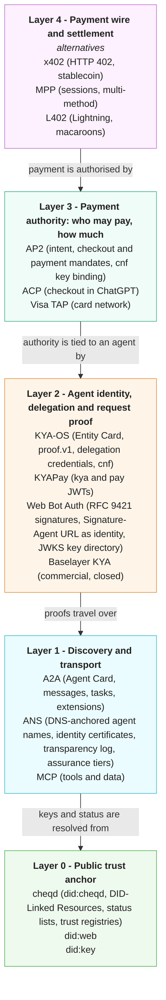
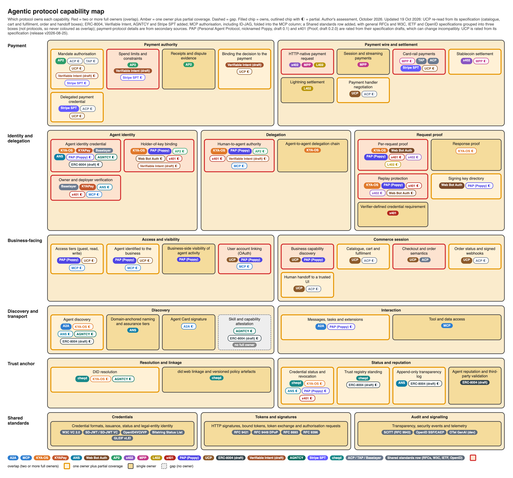
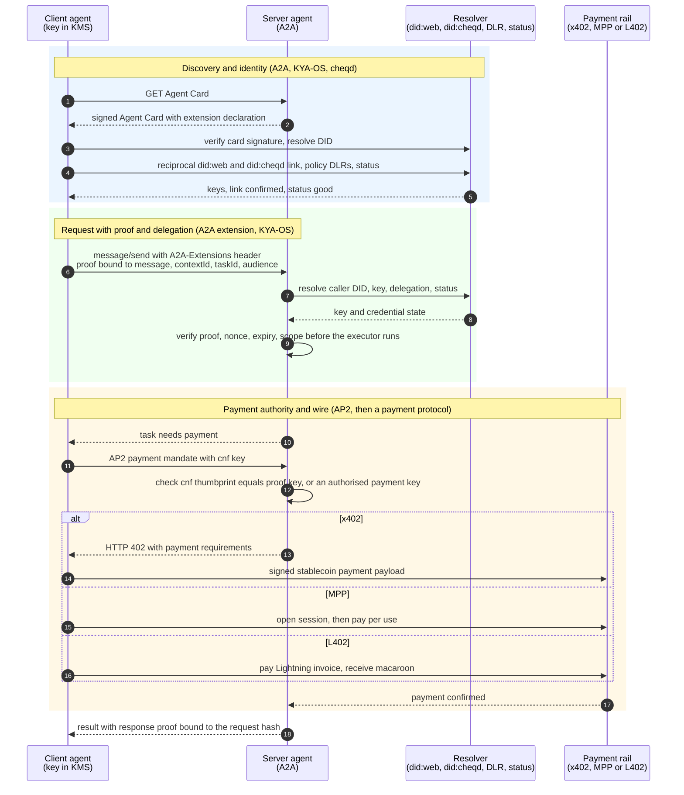

# Agentic protocol stack — capability map and composed flow

> **Working diagrams, not a specification.** The capability ratings are this author's assessment from public specifications and the research in [landscape-2026-10.md](./landscape-2026-10.md). The composed flow includes steps that exist only as a draft proposal and are marked as such. Payment-protocol details were taken from secondary sources and are *unverified*.

## 1. Capability map

Five layers, with the trust anchor underneath. Protocols at the same layer are alternatives or complements. They are not stacked on one another.

### Capability map with overlaps and gaps

Each box is one capability. Chips show which protocols cover it: filled means the protocol owns it, outlined with ◐ means partial. Red boxes have two or more full owners (real overlap). Amber boxes have one owner plus partial coverage. Dashed boxes have no owner. Dashed chips and dotted purple boxes mark provisional entries (none at present).

The ratings are data in [`tools/capability-map/generate.py`](./tools/capability-map/generate.py). Edit them and regenerate rather than redrawing the image; see its [README](./tools/capability-map/README.md).

A version without cheqd (no cheqd chips and no Trust anchor row) is at [`images/protocol-capability-map-neutral.png`](./images/protocol-capability-map-neutral.png). Generate it with the `--no-cheqd` toggle.

Seven protocols were added to the map in October 2026 (PAP, UCP and x401, then ERC-8004, Verifiable Intent, AGNTCY and Stripe Shared Payment Tokens), along with a new Business-facing row and a Shared standards row:

- **PAP (Personal Agent Protocol, nicknamed Poppy, Sierra and Meta)** is rated from draft 0.1 of its specification, published 9 Oct 2026 and read in its [source repository](https://github.com/personal-agent-protocol/personal-agent-protocol) (commit of 15 Oct). It is a draft and can change incompatibly. It owns holder-of-key binding, per-request proof and replay protection (DPoP-bound session tokens, RFC 9449), human-to-agent authority (OAuth sign-in with `poppy:read` and `poppy:write` scopes and a revocable account token), business capability discovery (`/.well-known/poppy.json`), access tiers (guest, read, write) and business-side visibility of agent activity. It is partial on agent identity credential (an agent is an HTTPS `client_id` URL with a key set, not a credential), messages and tasks, extension negotiation, signing key directory and credential status. See [pap-2026-10.md](./pap-2026-10.md).
- **UCP (Google Universal Commerce Protocol)** is rated from its specification (release v2026-08-25). It owns business capability discovery (a profile at `/.well-known/ucp`), checkout and order semantics, catalogue, cart and fulfilment (search, lookup, cart and fulfilment over REST, MCP and an embedded protocol), order status with signed webhooks, human handoff to a trusted UI, payment handler negotiation and user account linking (OAuth). It is partial on mandate authorisation (an extension carries AP2 mandates and does not define them), binding the decision to the payment, delegated payment credential, card-rail payments, access tiers and agent identified to the business, because it identifies the platform, not the agent. It has no DIDs, credentials, delegation chains, spend limits, revocation or x402 handler.

- **x401 (Proof)** is rated from draft 0.2.0 of its specification (editors from Proof and Circle), with the design goals, binding, agent identification, security and open-questions sections read. It is an HTTP proof requirement: the server returns 401 with a verifier-authored Digital Credentials request, and the agent retries with the result. It owns the verifier-defined credential requirement and is partial on owner and deployer verification, human-to-agent authority, holder-of-key binding, per-request proof, replay protection and credential status. It proves attributes of a credential holder, not the agent, and defines no payment, so it is not rated on spend limits. Agent binding is optional and delegation is an open question in the draft.

- **ERC-8004 (Trustless Agents)** is an Ethereum ERC draft (created 13 Aug 2025) read from the EIP: identity, reputation and validation registries on chain. It owns agent reputation and third-party validation, and is partial on agent identity credential, agent discovery, skill and capability attestation, trust registry standing and the append-only transparency log. Its registry counts come from secondary sources.
- **Verifiable Intent (Mastercard, draft v0.1)** is read from its specification repository: layered SD-JWT credentials binding the issuer, the user's intent and constraints, and the agent's action. It owns spend limits and constraints and binding the decision to the payment, and is partial on mandate authorisation, holder-of-key binding and human-to-agent authority. It was contributed to the FIDO Alliance Payments working group and has no commits since April 2026.
- **AGNTCY (Linux Foundation)** covers a schema framework (OASF), an agent directory, SLIM messaging and DID-based identity. It is partial only, on agent identity credential, agent discovery, skill and capability attestation and DID resolution. Its identity pages were read, and OASF and the directory specification were not read in full.
- **Stripe Shared Payment Tokens** are rated from Stripe's documentation (a proprietary API). They own delegated payment credential and card-rail payments, and are partial on mandate authorisation and spend limits and constraints.
- **MCP authorization** (spec revision 2026-07-28) and **ID-JAG** (an IETF OAuth draft behind MCP's Enterprise-Managed Authorization) are shown in the MCP column, which is partial on human-to-agent authority, owner and deployer verification, access tiers, agent identified to the business and user account linking.
- **Shared standards** (three boxes) group general specifications the stack builds on, not agent protocols: W3C VC 2.0, SD-JWT, OpenID4VC, Bitstring Status List and GLEIF vLEI; RFC 9421, DPoP, RFC 8693 and RFC 9396; SCITT, OpenID Shared Signals and OpenTelemetry. They are listed with status in [PROTOCOLS.md](./tools/capability-map/PROTOCOLS.md).

ANS (Agent Name Service) and Web Bot Auth were added after reading both Internet-Drafts in full. Both are early drafts. ANS is `draft-narajala-courtney-ansv2-01` (independent submission, Informational, shown as expired and archived). Web Bot Auth is `draft-ietf-webbotauth-httpsig-protocol-00` (working-group draft, Standards Track). See the bullets under the capability matrix for what each does and does not cover.

Counts for the full map: 45 capabilities, of which 12 overlap, 18 have partial overlap, 1 is a gap and 14 have a single owner.

| Kind | Capabilities |
|---|---|
| Overlap (two or more full owners) | Spend limits and constraints (AP2, Verifiable Intent, with Stripe SPT and Amex Intent Intelligence partial); HTTP-native payment request (x402, MPP, L402); card-rail payments (TAP, ACP, Stripe SPT, with MPP and UCP partial); agent identity credential (KYA-OS, KYAPay, Baselayer, ANS, with PAP, AGNTCY and ERC-8004 partial); holder-of-key binding (KYA-OS, PAP, with AP2, Web Bot Auth, x401 and Verifiable Intent partial); owner and deployer verification (Baselayer, KYAPay, with ANS, x401 and MCP partial); human-to-agent authority (KYA-OS, PAP, with AP2, x401, Verifiable Intent and MCP partial); per-request proof (KYA-OS, Web Bot Auth, PAP, with x401, x402 and L402 partial); replay protection (KYA-OS, PAP, with x401, x402 and Web Bot Auth partial); user account linking (UCP, PAP, with MCP partial); business capability discovery (UCP, PAP); checkout and order semantics (UCP, ACP) |
| Partial overlap | Mandate authorisation (AP2, with ACP, TAP, UCP, Verifiable Intent, Stripe SPT and Amex Intent Intelligence partial); receipts and dispute evidence (AP2, with Amex Intent Intelligence partial); binding the decision to the payment (Verifiable Intent, with UCP partial); delegated payment credential (Stripe SPT, with ACP, UCP and Amex Intent Intelligence partial); stablecoin settlement (x402, with MPP partial); payment handler negotiation (UCP, with ACP partial); signing key directory (Web Bot Auth, with PAP partial); access tiers (PAP, with UCP and MCP partial); agent identified to the business (PAP, with UCP and MCP partial); catalogue, cart and fulfilment (UCP, with ACP partial); order status and signed webhooks (UCP, with ACP partial); human handoff to a trusted UI (UCP, with ACP partial); agent discovery (A2A, with KYA-OS, ANS, AGNTCY and ERC-8004 partial); messages, tasks and extensions (A2A, with PAP partial); DID resolution (cheqd, with KYA-OS and AGNTCY partial); credential status and revocation (cheqd, with KYA-OS, ANS, PAP and x401 partial); trust registry standing (cheqd, with ERC-8004 partial); append-only transparency log (ANS, with ERC-8004 partial) |
| Gap | Skill and capability attestation (no full owner; AGNTCY and ERC-8004 are partial) |

### Capability matrix

● owns the capability  ◐ partial  ○ none

| Capability | A2A | ANS | Web Bot Auth | KYA-OS | AP2 | x402 | MPP | L402 | cheqd |
|---|---|---|---|---|---|---|---|---|---|
| Agent discovery | ● | ◐ (DNS-anchored names) | ○ | ◐ (Entity Card) | ○ | ○ | ◐ | ○ | ○ |
| Message and task transport | ● | ○ | ○ | ○ | ○ | ○ | ◐ | ○ | ○ |
| Agent identity | ◐ (signed card, no key trust model) | ● (identity certificate) | ◐ (URL as identifier, no operator identity) | ● | ◐ (key binding only) | ○ | ◐ | ○ | ● (anchor) |
| Delegated authority | ○ (multi-hop identity loss) | ○ | ○ (out of scope) | ● | ◐ (agent-to-agent out of scope) | ○ | ○ | ○ | ○ |
| Per-request proof | ○ | ○ (mTLS, channel-level) | ● (HTTP message signature) | ● | ○ | ◐ (payment signature) | ◐ | ◐ (macaroon) | ○ |
| Payment authority | ○ | ○ | ○ | ○ | ● | ○ | ◐ | ○ | ○ |
| Payment wire | ○ | ○ | ○ | ○ | ○ | ● | ● | ● | ○ |
| Settlement | ○ | ○ | ○ | ○ | ○ | ● (USDC on-chain) | ◐ (cards and stablecoin) | ● (Lightning) | ○ |
| Revocation and status | ○ | ◐ (lifecycle events in log; identity-cert revocation unspecified) | ○ (no revocation, keys expire out of the directory) | ● | ◐ | ○ | ○ | ○ | ● |

Reading the matrix:

- **A2A and KYA-OS are complementary.** A2A carries the interaction. KYA-OS supplies what A2ABreak found missing: key trust, delegation and request proof.
- **AP2 and x402 sit at different layers.** AP2 says whether an agent may pay. x402 is one way the payment travels. They are not rivals.
- **x402, MPP and L402 compete** at layer 4. MPP is reported to accept x402 as one of its payment methods, so the two also overlap.
- **ANS and Web Bot Auth are complementary.** ANS answers *which agent is this and should I trust its domain*: a name, a certificate and an assurance tier. Web Bot Auth answers *did the holder of this key sign this request*: an HTTP message signature, with the key found at a URL the agent names in `Signature-Agent`.
- **Neither carries delegation.** Web Bot Auth defers it (a chained signature shows forwarding, not authorisation). ANS only mentions a W3C Verifiable Credential for a platform registering on a tenant's behalf, and an RFC 8693 token for human authority. KYA-OS remains the only full owner.
- **Web Bot Auth identifies a URL, not an operator.** The draft says the signature proves control of a published key and says nothing about who runs the agent, and it excludes trust accrual and authorisation. It defines no revocation: removal from the directory takes effect when caches expire. Both are places where a ledger-anchored identity and status could plug in.
- **ANS authenticates the channel, not each request.** The agent proves itself by mTLS and a sealed badge. Detached JWS signing is used for registration-authority API calls only, so ANS does not own per-request proof.
- **ANS names a DID as a complement, not a dependency.** Its principal binding can carry a DID, and `did:web` and `did:ethr` are listed as future work. `did:cheqd` is not mentioned. Its transparency log (SCITT-style, Merkle proofs, COSE receipts) is an alternative to ledger anchoring for lifecycle evidence.
- **Both are early drafts.** Web Bot Auth is `draft-ietf-webbotauth-httpsig-protocol-00` (1 Sep 2026, Standards Track, working-group draft, Cloudflare and Google authors). ANS is `draft-narajala-courtney-ansv2-01` (13 Apr 2026, independent submission, Informational; authors from GoDaddy, OWASP, DistributedApps.ai and Cisco), shown as expired and archived on the Datatracker. ANS has internal inconsistencies, for example OV or EV server certificates in Table 1 against a DV example in Appendix A.3, and its Trust Index and federation are described but not specified.
- **cheqd is not a protocol in this stack.** It supplies durable, independently resolvable identity and status that layers 1 to 3 can reference.
- **Gaps:** nothing here ties the signed *decision* to the payment. The AP2 whisper-attack paper reports this gap, and key binding does not close it.

## 2. Composed flow

One agent calling a paid service. The table after the diagram says which steps rest on existing mechanisms and which on draft proposals.

### What each step relies on

| Steps | Mechanism | Status |
|---|---|---|
| 1-5 | A2A Agent Card signing, KYA-OS Entity Card, cheqd resolution and status | Card signing is in A2A. Resolver and linkage are proposed in the draft specification |
| 6-9 | `A2A-Extensions` negotiation, `org.kya-os/proof.v1`, verification order | Header is in A2A. The A2A binding is a draft proposal |
| 10-12 | AP2 mandate, `cnf` thumbprint rule | Mandate is in AP2 v0.2.0. The thumbprint rule is a draft proposal |
| 13-17 | Payment protocols | Described in secondary sources only. How AP2 composes with each is unverified |
| 18 | Response proof | Draft proposal |

### Limits of this flow

- **Order of the payment steps is illustrative.** Real AP2 flows differ for human-present and autonomous cases.
- **Streaming, push notifications and non-JSON-RPC transports** are not shown, and are out of scope for the draft v1.
- **The whisper-attack risk is not mitigated here.** Nothing in this flow verifies the decision that produced the mandate.
